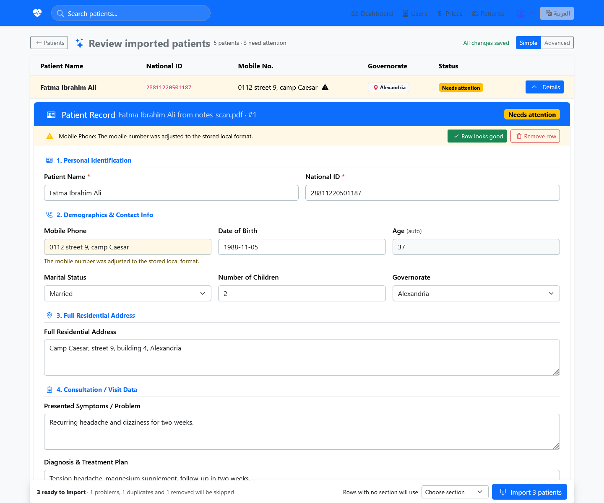
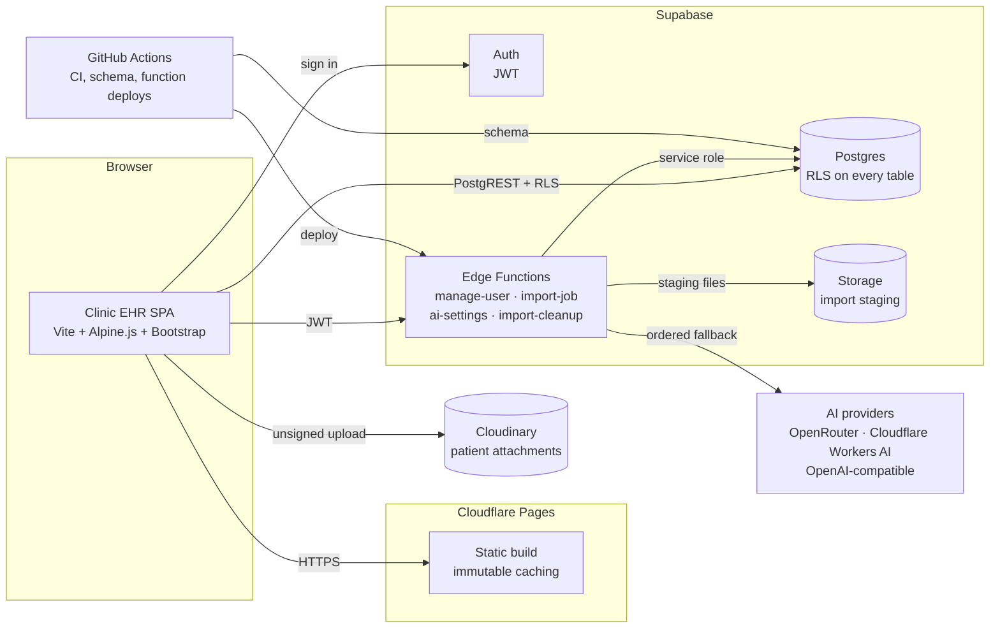

<div align="center">

# Clinic EHR

**A serverless electronic health record system for multi-section clinics.**

[Live demo](https://clinc-ehr.pages.dev) · [Features](#features) · [Architecture](#architecture) · [Getting started](#getting-started) · [Documentation](#documentation)

[](https://github.com/YossefKhalil/Clinic-EHR-System/actions/workflows/ci.yml)
[](https://clinc-ehr.pages.dev)
[](LICENSE)
[](#prerequisites)

</div>

## Overview

Clinic EHR is a cloud-native electronic health record system for clinics with multiple sections. It covers patient registration, clinical notes, attachments, pricing, reporting, and administration in one bilingual interface.

The application is deliberately serverless. The frontend is a static Vite build served by Cloudflare Pages. Supabase provides Postgres, authentication, storage, and Edge Functions, while Cloudinary stores patient attachments. There is no PHP runtime, container, or VPS to provision, patch, or scale.

> Clinic EHR was rebuilt from [BelalAhmed2214/health](https://github.com/BelalAhmed2214/health), a Laravel application. The clinic workflow and Bootstrap interface are preserved; the runtime is not.

### At a glance

| Area | Details |
| --- | --- |
| **Status** | Core EHR stable · AI-assisted import in preview |
| **Frontend** | Vite 5, Alpine.js 3, Bootstrap 5.3 |
| **Backend** | Supabase Postgres, Auth, Storage, Edge Functions |
| **Attachments** | Cloudinary |
| **Hosting** | Cloudflare Pages |
| **Languages** | English and Arabic, with full RTL |
| **Access control** | Postgres RLS and JWT-gated Edge Functions |
| **License** | MIT |

## Contents

- [Overview](#overview)
- [Features](#features)
- [AI-assisted patient import](#ai-assisted-patient-import-preview)
- [Architecture](#architecture)
- [Tech stack](#tech-stack)
- [Security model](#security-model)
- [Getting started](#getting-started)
- [Deployment](#deployment)
- [Testing](#testing)
- [Project structure](#project-structure)
- [Status and roadmap](#status-and-roadmap)
- [Documentation](#documentation)
- [Contributing](#contributing)
- [License](#license)
- [Acknowledgements](#acknowledgements)

## Features

### Clinical records

- **Patient registry** with a 17-field intake form: identity, contact details, demographics, address, visit information, diagnosis and treatment plan, funding source, price, and section.
- **Patient profiles** with editable records, internal notes, completion status, and attachments.
- **Attachments** for medical and lab documents. Files upload directly from the browser to Cloudinary with progress and are served through its CDN.
- **Section-aware access**: staff see and edit only patients in their assigned section; administrators see every section.

### Search and reporting

- **Global search** across every patient field, with Arabic-aware normalization and fuzzy matching. Results support full keyboard navigation.
- **Dashboard** with total, completed, and pending counts, section and source breakdowns, a financial summary (grand total, by section, by funding source), and a recent-patients table.
- **Excel export** of the current patient list. SheetJS is loaded only when an export is requested.

### Administration

- **User management** inside Settings through the `manage-user` Edge Function: create, edit, and remove users, assign administrator rights, and set section access.
- **Editable option lists** for followers, sections, and funding sources, with English and Arabic labels and an active/inactive state. Changes apply without a redeploy.
- **AI import settings** for administrators: provider credentials, an ordered model fallback chain, the feature flag, and import quotas.

### Experience

- **Bilingual by design**: instant English/Arabic switching, full RTL layout, localized ARIA labels, and a persisted language preference.
- **Single-page workflow**: views switch without reloads, and record edits update in place.
- **Responsive layout** for desktop and mobile, including a mobile navigation bar.
- **Lazy loading** for spreadsheet, document, and PDF libraries, so the initial bundle stays small.
- **Deployment resilience**: a guarded `vite:preloadError` handler recovers from stale chunks after a redeploy.

## AI-assisted patient import (preview)

> **Preview status.** Extraction and review are implemented on this branch. The final commit step that writes reviewed rows into the patient registry is still in development, so the import action is intentionally a placeholder. The feature is disabled by default and hidden from staff until an administrator enables it.

The import agent turns existing records into structured patient drafts, then gives staff a review surface before anything reaches the registry.

### Supported inputs

| Input | Formats |
| --- | --- |
| Spreadsheets | XLSX, XLSM, XLS, one source per visible sheet |
| Delimited text | CSV and TSV, with encoding and delimiter detection |
| Documents | DOCX and text-layer PDF |
| Images | Photos of paper notes (PNG, JPEG, WebP, GIF, BMP, HEIC) |
| Text | Pasted text |

Files are identified by content signature, not by extension. Oversized files, encrypted PDFs, and zip bombs are rejected before parsing.

### Pipeline

1. **Read and chunk.** The browser extracts text and tables, assigns stable source-line identifiers, and splits the result into bounded chunks. Spreadsheet headers are repeated per chunk; tall note images are tiled with overlap.
2. **Extract.** The `import-job` Edge Function runs each chunk through the administrator's ordered provider chain. Transient provider failures fall through to the next ready entry; malformed output gets one repair pass; truncated output is split and re-queued.
3. **Validate.** Extracted records are normalized and validated against the registry rules, checked for duplicates, and stored as reviewable rows with source citations.
4. **Review.** Staff correct the draft in a table that mirrors the patients page. Nothing is written to the patient registry during extraction.

### Review workflow

- **Simple and Advanced modes.** Simple shows the five scan columns; Advanced adds issue filters, duplicate resolution, source quotes, bulk fill, and row-level actions.
- **Complete record editing.** Every row opens the full 17-field record, grouped like the intake form.
- **Problem-first review.** Rows carry severity flags, a "Next issue" walkthrough, and duplicate actions: fill missing fields, keep as new, or skip.
- **Resumable jobs.** Progress survives a tab close. Failed chunks can be retried individually, and a running job can be cancelled; in-flight provider calls are aborted.
- **Quotas and feature flags.** Per-job token caps, daily user caps, and an administrator-controlled feature flag bound usage.

<p align="center">
  
</p>
<p align="center"><em>Review screen in Simple mode, using mock data.</em></p>

### Providers and credentials

- **OpenRouter**, **Cloudflare Workers AI**, and any **OpenAI-compatible** endpoint, including OpenAI, Groq, Ollama, and LM Studio.
- Providers can be mixed in an ordered chain of up to eight model entries.
- Provider keys are stored AES-GCM encrypted, decrypted only inside Edge Functions, and never returned to the browser.
- OpenRouter requests are sent with `data_collection: deny`. Other providers have their own retention and training policies.

> **Privacy.** Enabling AI import sends extracted text, and for photos the images themselves, to the configured provider. Review the provider's data-handling terms and your clinic's consent and retention obligations before enabling the feature with patient data.

## Architecture



**Request path**

- Static assets are served from Cloudflare's edge; there is no application server in the request path.
- The browser authenticates with Supabase Auth and queries Postgres through PostgREST. Row-level security decides what each JWT may read or write.
- Privileged operations go through Edge Functions that verify the caller's JWT and role, then use the service-role client server-side.
- Attachments upload directly from the browser to Cloudinary, so file traffic never passes through the app.
- AI provider keys are decrypted inside `import-job` and never reach the client.

**Design trade-offs**

- Authorization lives in the database rather than in client code, so a compromised or modified frontend cannot widen access.
- A static frontend and managed services keep the operational surface small: no servers to patch, no session store, no file volume.
- The same trade-off removes PHP-level server control. The original Laravel application remains the better fit if that control is required.

## Tech stack

| Layer | Technology |
| --- | --- |
| Frontend | Vite 5, Alpine.js 3, Bootstrap 5.3, Bootstrap Icons |
| Backend | Supabase Postgres, Auth, Storage, Edge Functions |
| Database | PostgreSQL with row-level security |
| File storage | Cloudinary |
| AI extraction | OpenRouter, Cloudflare Workers AI, OpenAI-compatible endpoints |
| Documents | SheetJS, mammoth, PDF.js |
| Hosting | Cloudflare Pages |
| CI/CD | GitHub Actions |
| Testing | Vitest, PGlite, fast-check |

## Security model

### Authentication and authorization

- Supabase Auth issues JWTs, and row-level security is enabled on every application table.
- Section staff are scoped to their section by RLS policies; administrators bypass section scoping.
- Policies use `SECURITY DEFINER` helpers (`is_admin`, `is_section_user`) with `EXECUTE` revoked from `PUBLIC`, avoiding recursive policy evaluation.
- New accounts are created unprivileged. `handle_new_user()` ignores signup metadata for `is_admin` and `section`, preventing privilege escalation at registration.

### Privileged operations

- Edge Functions verify the caller's JWT and role before using the service-role client.
- `manage-user` and `ai-settings` are administrator-only; `import-job` scopes jobs to their owner.
- The service-role key is never included in the frontend bundle.

### Secrets and AI credentials

- AI provider credentials live in `ai_settings`, which is removed from the PostgREST API surface.
- Keys are encrypted with AES-GCM-256 using a key derived with HKDF-SHA256 from the dedicated `AI_SETTINGS_ENC_KEY` secret, not from the service-role key.
- The browser receives configuration status only, never a stored key.

### Data integrity

- National IDs are unique. The Egyptian national ID structure is decoded to validate the date of birth and governorate, and mobile numbers are normalized to the local format.
- Option values are validated by a database trigger against `app_options`; deactivated options remain valid on historical records.
- `updated_at` is maintained by triggers, and the registrar's name is denormalized at write time for section-scoped reads.
- Date filters convert local day boundaries to UTC before comparing `timestamptz` values.

### Operational notes

- Cloudinary uploads use an unsigned preset. Scope the preset to the expected file types and size, and monitor usage; the preset is not an authentication boundary.
- This repository is a software project, not a certified medical device or a compliance package. Deployers are responsible for their own regulatory, consent, retention, and security obligations.

## Getting started

### Prerequisites

- **Node.js 20+** and npm. CI uses Node 22.
- A **Supabase** project. The free tier is sufficient for development and small deployments.
- A **Cloudinary** account for patient attachments. Optional for a records-only setup.
- A **Cloudflare Pages** account for deployment. Optional for local development.
- The **Supabase CLI** for deploying Edge Functions or applying the schema from a terminal.

### 1. Clone and install

```bash
git clone https://github.com/YossefKhalil/Clinic-EHR-System.git
cd Clinic-EHR-System
npm install
```

### 2. Configure the frontend

Copy the environment template and fill in your project values:

```bash
cp .env.example .env
```

```dotenv
VITE_SUPABASE_URL=https://<project-ref>.supabase.co
VITE_SUPABASE_ANON_KEY=<anon-key>
VITE_CLOUDINARY_CLOUD_NAME=<cloud-name>
VITE_CLOUDINARY_UPLOAD_PRESET=clinic_ehr_uploads
```

| Variable | Required | Purpose |
| --- | --- | --- |
| `VITE_SUPABASE_URL` | Yes | Supabase project URL |
| `VITE_SUPABASE_ANON_KEY` | Yes | Public anon key; RLS enforces access |
| `VITE_CLOUDINARY_CLOUD_NAME` | For attachments | Cloudinary cloud name |
| `VITE_CLOUDINARY_UPLOAD_PRESET` | For attachments | Unsigned upload preset |

These values are public and are embedded at build time. Never put a service-role key or an AI provider secret in a `VITE_*` variable.

### 3. Create the database

Run [`supabase/schema.sql`](supabase/schema.sql) in the Supabase SQL Editor. It creates the tables, triggers, indexes, RLS policies, and the import tables.

The file is idempotent: re-running it on an existing database recreates policies and backfills missing profile rows, so it doubles as the repair path. After applying it, run [`supabase/verify-schema.sql`](supabase/verify-schema.sql) to check the columns the Edge Functions depend on.

To apply the schema from CI, add the `SUPABASE_DB_URL` repository secret and run the **Supabase Schema** workflow. Use the shared session pooler on port `5432` (or a direct connection), not the transaction pooler on port `6543`, which cannot reliably run DDL.

> For long-term maintenance, move to versioned Supabase CLI migrations. This repository currently uses one idempotent schema file.

### 4. Deploy the Edge Functions

```bash
supabase login
supabase link --project-ref <project-ref>
supabase functions deploy manage-user
supabase functions deploy import-cleanup --no-verify-jwt
supabase functions deploy import-job
supabase functions deploy ai-settings
```

`import-extract` is a shared module imported by `import-job`; it is not deployed as a separate function.

Set the project secrets:

```bash
supabase secrets set AI_SETTINGS_ENC_KEY="$(openssl rand -base64 32)"
supabase secrets set IMPORT_CLEANUP_SECRET="$(openssl rand -hex 32)"
```

- `AI_SETTINGS_ENC_KEY` encrypts stored provider credentials. Store it securely. Rotating it makes existing credentials unreadable, so re-enter them in Settings after a rotation.
- `IMPORT_CLEANUP_SECRET` authenticates the scheduled retention call. The `import-cleanup` function is deployed without the default JWT check because `pg_cron` calls it with an `x-cleanup-secret` header.
- Supabase provides `SUPABASE_SERVICE_ROLE_KEY` to hosted functions. Confirm it is present in your project's function secrets before deploying.

### 5. Create the first administrator

New accounts have no administrator rights and no section. After signing up, promote the first administrator in the SQL Editor:

```sql
update public.users
set is_admin = true
where email = 'you@example.com';
```

Administrators can then assign roles and sections from Settings.

### 6. Run locally

```bash
npm run dev
```

Vite serves the app at `http://localhost:5173`. The AI import review screen has a mock route for UI work that needs no login or live data:

```text
http://localhost:5173/?mock=review
```

### 7. Build

```bash
npm run build
npm run preview
```

The production build is written to `dist/`.

## Deployment

### Cloudflare Pages

Connect the repository to a Cloudflare Pages project and use:

| Setting | Value |
| --- | --- |
| Build command | `npm run build` |
| Output directory | `dist` |
| Node version | 22 |

Add the four `VITE_*` variables from `.env.example` as **build environment variables** in the Pages project. They are read at build time; runtime variables are not used by a static build.

### GitHub Actions

| Workflow | Trigger | Purpose |
| --- | --- | --- |
| **CI** | Push and pull request | Install, lint, registry check, tests with coverage, build |
| **Deploy Edge Functions** | Push touching `supabase/functions/**` or `supabase/schema.sql` | Apply the schema, provision the encryption secret once, deploy the functions |
| **Supabase Schema** | Manual | Apply and verify `supabase/schema.sql` |
| **Keep-alive** | Daily schedule | Ping the Supabase auth health endpoint so a free-tier project does not pause |

The deploy workflow targets the project ref defined in `.github/workflows/deploy-functions.yml`. Change it to your own project ref before using the workflow in a fork.

### Repository secrets

| Secret | Used by | Purpose |
| --- | --- | --- |
| `SUPABASE_DB_URL` | Schema, Deploy | Postgres connection string for schema application |
| `SUPABASE_ACCESS_TOKEN` | Deploy | Supabase CLI authentication |
| `SUPABASE_URL` | Keep-alive | Project URL |
| `SUPABASE_KEY` | Keep-alive | Public anon key |

## Testing

```bash
npm test               # unit and RLS suites
npm run test:coverage  # coverage gate used by CI
npm run test:db        # RLS policies only
npm run lint           # ESLint
npm run check:registry # field registry and schema contract
```

The suite currently contains **428 tests across 35 files**. RLS tests run against an in-process Postgres (PGlite) loaded with `supabase/schema.sql`, so policies are exercised against real SQL rather than mocks. Import fixtures cover XLSX, CSV, DOCX, and PDF readers, and property-based tests cover the normalizers.

CI runs lint, the registry check, coverage, and the production build on every push and pull request.

## Project structure

```text
.
├── index.html                     # SPA shell and all page templates
├── src/
│   ├── main.js                    # Alpine application controller
│   ├── features/import-agent/     # Readers, extraction client, review state, UI
│   │   ├── readers/               # XLSX, CSV, DOCX, PDF, image, text readers
│   │   ├── api.js                 # import-job / ai-settings client
│   │   ├── intake.js              # File validation and hashing
│   │   ├── review.js              # Review state, validation, duplicate logic
│   │   └── ui.js                  # Import wizard and review screen
│   ├── locales/                   # English and Arabic translations
│   ├── services/                  # Supabase, patients, prices, users, options, export
│   └── styles/                    # Bootstrap overrides and RTL styles
├── supabase/
│   ├── schema.sql                 # Tables, triggers, RLS, import schema
│   ├── verify-schema.sql          # Column checks used by CI
│   ├── seed.sql                   # Seed notes
│   └── functions/
│       ├── _shared/               # Shared import-core, LLM, and crypto modules
│       ├── ai-settings/           # Encrypted provider settings
│       ├── import-cleanup/        # Retention and storage purge
│       ├── import-job/            # Import job orchestration and extraction
│       └── manage-user/           # Administrator user CRUD
├── tests/
│   ├── fixtures/                  # Reader and pipeline fixtures
│   ├── rls/                       # Postgres RLS tests
│   └── unit/                      # Reader, pipeline, review, and normalizer tests
├── docs/                          # Design notes and import architecture
├── scripts/                       # Registry and fixture tooling
├── .github/workflows/             # CI, schema, function deploys, keep-alive
├── .env.example
├── package.json
└── vite.config.js
```

## Status and roadmap

### Stable

- Patient registry, profiles, attachments, global search, dashboard with financial summary, and Excel export.
- User management, section-scoped access, and editable option lists.
- Complete English/Arabic interface with RTL support.

### Preview

- **AI-assisted import**: readers, extraction pipeline, provider fallback chain, encrypted settings, review UI, quotas, retries, and resume are implemented. The commit-to-registry step remains.

### Planned

- Versioned Supabase migrations.
- Import batch undo and usage/cost reporting.
- Expanded browser-level test coverage.

## Documentation

- [AI import design and milestones](docs/import-agent/): pipeline, readers, persistence, review UI, provider settings, and the latest audit.
- [Database schema](supabase/schema.sql) and [schema verification](supabase/verify-schema.sql).
- [Environment template](.env.example).

## Contributing

Contributions are welcome. Open an issue to discuss substantial changes, keep pull requests focused, and run the following before submitting:

```bash
npm run lint
npm test
npm run build
```

When changing the database, update `supabase/schema.sql` and `supabase/verify-schema.sql` together.

## License

Released under the MIT License. See [LICENSE](LICENSE).

## Acknowledgements

- [BelalAhmed2214/health](https://github.com/BelalAhmed2214/health) for the original Laravel application and clinic workflow.
- The Supabase, Cloudinary, Cloudflare, Bootstrap, Alpine.js, and Vite teams.
- Maintained by [Yossef Khalil](https://github.com/YossefKhalil).
