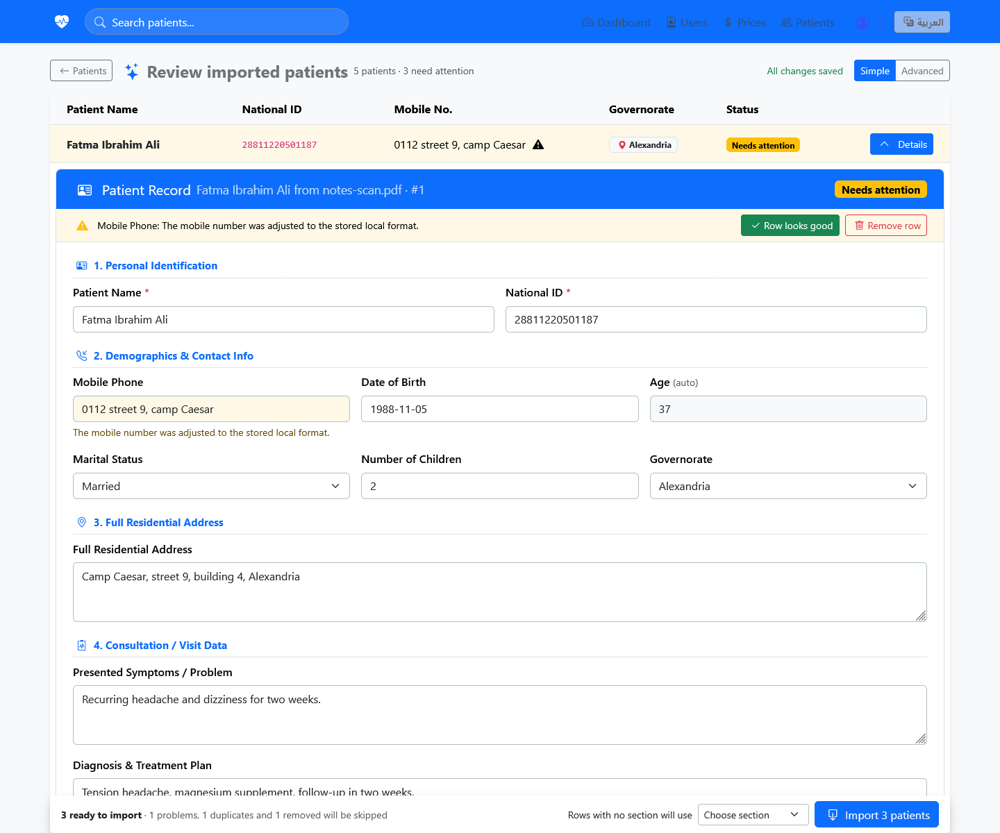
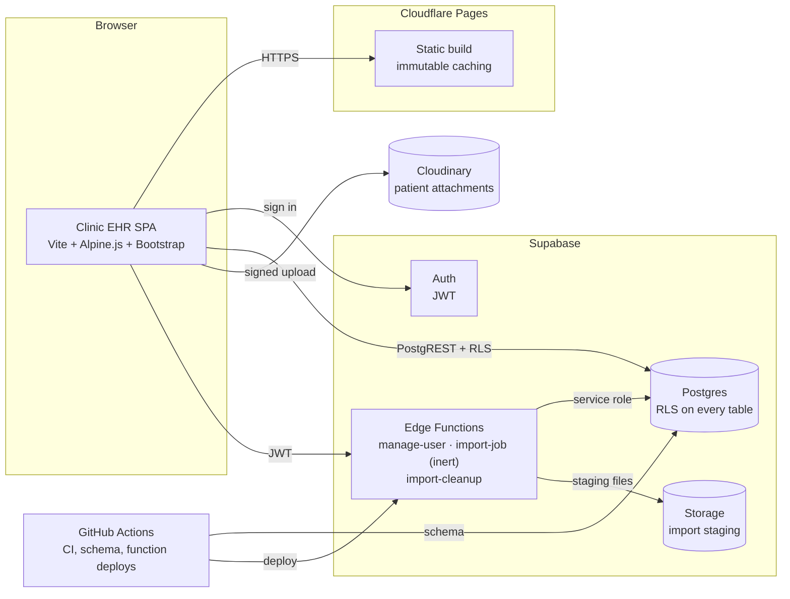

<div align="center">

<p align="center">
  
</p>

# Clinic EHR

**A serverless electronic health record system for multi-section clinics.**

[Live demo](https://clinc-ehr.pages.dev) · [Features](#features) · [Architecture](#architecture) · [Getting started](#getting-started) · [Documentation](#documentation)

[](https://github.com/YossefKhalil/Clinic-EHR-System/actions/workflows/ci.yml)
[](https://clinc-ehr.pages.dev)
[](LICENSE)
[](#prerequisites)

</div>

## Overview

Clinic EHR is a cloud-native electronic health record system for clinics with multiple sections. It covers patient registration, clinical notes, attachments, pricing, reporting, and administration in one bilingual interface.

The application is deliberately serverless. The frontend is a static Vite build served by Cloudflare Pages. Supabase provides Postgres, authentication, storage, and Edge Functions, while Cloudinary stores patient attachments. There is no PHP runtime, container, or VPS to provision, patch, or scale.

> Clinic EHR was rebuilt from [BelalAhmed2214/health](https://github.com/BelalAhmed2214/health), a Laravel application. The clinic workflow and Bootstrap interface are preserved; the runtime is not.

### At a glance

| Area | Details |
| --- | --- |
| **Status** | Core EHR stable · AI import disabled pending the CPU-only rebuild |
| **Frontend** | Vite 5, Alpine.js 3, Bootstrap 5.3 |
| **Backend** | Supabase Postgres, Auth, Storage, Edge Functions |
| **Attachments** | Cloudinary |
| **Hosting** | Cloudflare Pages |
| **Languages** | English and Arabic, with full RTL |
| **Access control** | Postgres RLS and JWT-gated Edge Functions |
| **License** | MIT |

## Contents

- [Overview](#overview)
- [Features](#features)
- [AI-assisted patient import](#ai-assisted-patient-import-preview)
- [Architecture](#architecture)
- [Tech stack](#tech-stack)
- [Security model](#security-model)
- [Getting started](#getting-started)
- [Deployment](#deployment)
- [Testing](#testing)
- [Project structure](#project-structure)
- [Status and roadmap](#status-and-roadmap)
- [Documentation](#documentation)
- [Contributing](#contributing)
- [License](#license)
- [Acknowledgements](#acknowledgements)

## Features

### Clinical records

- **Patient registry** with a 17-field intake form: identity, contact details, demographics, address, visit information, diagnosis and treatment plan, funding source, price, and section. The National ID is optional, and contact details accept multiple phone numbers.
- **Patient profiles** with editable records, internal notes, completion status, and attachments.
- **Printable patient record**: **Print / Save PDF** opens a bilingual A4 report with a plain black-and-white letterhead and the patient's identity, visit, clinical notes, and attachment names. It follows the active app language, compacts the identity and visit grids to fit more data on page one, and can append each attached image as an optional separate page. The main record auto-fits to one page down to 8pt and adds a labelled continuation instead of truncating clinical text. The report module is lazy-loaded.
- **Attachments** for medical and lab documents. Photos are downscaled to a 1600px long side and re-encoded in the browser (WebP/JPEG, EXIF orientation respected, metadata stripped) before uploading directly to Cloudinary; PDFs upload unchanged. Cards and upload rows load 256/800px signed derivatives, and the original is requested only when the record is opened. The full asset can still be kept with `VITE_COMPRESS_ATTACHMENTS=false`.
- **Section-aware access**: staff are granted read and/or write access per section; a Super Admin reaches every section and manages accounts.

### Search and reporting

- **Global search** across every patient field, with Arabic-aware normalization and fuzzy matching. A trigger-maintained `search_text` column with a `pg_trgm` GIN index keeps the query fast as the registry grows. Results support full keyboard navigation.
- **Dashboard** with total, completed, and pending counts, section and source breakdowns, a financial summary (grand total, by section, by funding source), and a recent-patients table. Counts and totals come from `SECURITY INVOKER` aggregate RPCs, so section RLS still applies but PostgREST's 1000-row limit cannot truncate them.
- **Excel export** in Arabic by default, with a caret for the language, the rows (all filtered, this page, or the ticked patients) and the columns. Filtered exports page through every matching row; SheetJS is loaded only when an export is requested.

### Administration

- **User management** inside Settings through the `manage-user` Edge Function: only Super Admins create, edit, or delete accounts, set the Super Admin role, and grant read/write access per section (write implies read).
- **Editable option lists** for followers, sections, and funding sources, with English and Arabic labels and an active/inactive state. Changes apply without a redeploy.
- **AI import settings** for administrators: provider credentials, an ordered model fallback chain, the feature flag, and import quotas.

### Experience

- **Bilingual by design**: instant English/Arabic switching, full RTL layout, localized ARIA labels, and a persisted language preference.
- **Notifications** stack as toasts in the corner and dismiss themselves; nothing is pushed down the page.
- **Single-page workflow**: views switch without reloads, and record edits update in place.
- **Responsive layout** for desktop and mobile, including a mobile navigation bar.
- **Lazy loading** for spreadsheet, document, and PDF libraries, so the initial bundle stays small.
- **Deployment resilience**: a guarded `vite:preloadError` handler recovers from stale chunks after a redeploy.

## AI-assisted patient import

> **Status: disabled.** The AI import agent is intentionally unavailable while its runtime is rebuilt as a CPU-only, local-only engine. The old WebGPU/MLC runtime and every cloud inference path were removed. There is deliberately no setting, flag, or credential that can turn extraction back on. The readers, review state, and commit path remain in the repository for the rebuild, but the entry is hidden and the server refuses every job action.

The import agent turns existing records into structured patient drafts, then gives staff a review surface before anything reaches the registry.

### Supported inputs

| Input | Formats |
| --- | --- |
| Spreadsheets | XLSX, XLSM, XLS, one source per visible sheet |
| Delimited text | CSV and TSV, with encoding and delimiter detection |
| Documents | DOCX and text-layer PDF |
| Images | Photos of paper notes (PNG, JPEG, WebP, GIF, BMP, HEIC) |
| Text | Pasted text |

Files are identified by content signature, not by extension. Oversized files, encrypted PDFs, and zip bombs are rejected before parsing.

### Pipeline (dormant until the CPU rebuild)

1. **Read and chunk.** The browser extracts text and tables, assigns stable source-line identifiers, and splits the result into bounded chunks. Spreadsheet headers are repeated per chunk; tall note images are tiled with overlap.
2. **Extract.** Disabled. The old `import-job` cloud provider chain and the browser MLC/WebGPU engine were removed.
3. **Validate.** Extracted records are normalized and validated against the registry rules, checked for duplicates, and stored as reviewable rows with source citations.
4. **Review.** Staff correct the draft in a table that mirrors the patients page. Nothing is written to the patient registry during extraction.
5. **Commit.** Reviewed rows are written to the patient registry with the registrar's context and import provenance.

### CPU-only rebuild

The replacement runs entirely in the browser on the CPU, with no server inference and no model upload:

- **Model**: LiquidAI LFM3-VL-2B (QAD-Q4_0 GGUF, 1.05 GB) plus the Q8_0 `mmproj` projector (203 MB), so text and images share one 2B model.
- **Runtime**: llama.cpp compiled to WebAssembly through wllama, with the WASM SIMD kernel fix, relaxed-SIMD kernels behind a safe x86 guard, `SharedArrayBuffer` multithreading when COOP/COEP are available, and a single-thread fallback everywhere else.
- **UI**: the same browse-or-download flow: pick both files from local storage, or download them from Hugging Face, verify them, and load them in place. Files stay in the browser.
- **Networks**: cloud providers, credentials, consent, and the `ai-settings` function are gone. Import stays unreachable until this engine ships.

### Review workflow

- **Simple and Advanced modes.** Simple shows the five scan columns; Advanced adds issue filters, duplicate resolution, source quotes, bulk fill, and row-level actions.
- **Complete record editing.** Every row opens the full 17-field record, grouped like the intake form.
- **Problem-first review.** Rows carry severity flags, a "Next issue" walkthrough, and duplicate actions: fill missing fields, keep as new, or skip.
- **Resumable jobs.** Progress survives a tab close. Failed chunks can be retried individually, and a running job can be cancelled; in-flight provider calls are aborted.
- **Quotas and feature flags.** Per-job token caps, daily user caps, and an administrator-controlled feature flag bound usage.

<p align="center">
  
</p>
<p align="center"><em>Review screen in Simple mode, using mock data.</em></p>

### Providers and credentials

There are none. Cloud provider adapters, encrypted credentials, the provider chain, cloud consent, and the `ai-settings` function were removed with the old runtime.

> **Privacy.** The CPU rebuild keeps extraction on the clinic PC. Patient text and images must never be sent to a cloud provider.

## Architecture



**Request path**

- Static assets are served from Cloudflare's edge; there is no application server in the request path.
- The browser authenticates with Supabase Auth and queries Postgres through PostgREST. Row-level security decides what each JWT may read or write.
- Privileged operations go through Edge Functions that verify the caller's JWT and role, then use the service-role client server-side.
- Attachments upload directly from the browser to Cloudinary, so file traffic never passes through the app.
- AI inference has no server path. The CPU rebuild runs entirely in the browser; the deployed `import-job` function is inert and refuses every job action.

**Design trade-offs**

- Authorization lives in the database rather than in client code, so a compromised or modified frontend cannot widen access.
- A static frontend and managed services keep the operational surface small: no servers to patch, no session store, no file volume.
- The same trade-off removes PHP-level server control. The original Laravel application remains the better fit if that control is required.

## Tech stack

| Layer | Technology |
| --- | --- |
| Frontend | Vite 5, Alpine.js 3, Bootstrap 5.3, Bootstrap Icons |
| Backend | Supabase Postgres, Auth, Storage, Edge Functions |
| Database | PostgreSQL with row-level security |
| File storage | Cloudinary |
| AI import | Disabled pending the CPU-only rebuild (wllama + llama.cpp WASM, LFM3-VL-2B QAD-Q4_0 + mmproj) |
| Documents | SheetJS, mammoth, PDF.js |
| Hosting | Cloudflare Pages |
| CI/CD | GitHub Actions |
| Testing | Vitest, PGlite, fast-check |

## Security model

### Authentication and authorization

- Supabase Auth issues JWTs, and row-level security is enabled on every application table.
- Section staff are scoped to the sections granted on their profile by RLS policies; a Super Admin bypasses section scoping. Patient policies resolve the caller's sections once per query (`readable_sections()`/`writable_sections()`) instead of running a SECURITY DEFINER scalar helper for every row.
- Policies use `SECURITY DEFINER` helpers (`is_super_admin`, `can_read_section`, `can_write_section`) with `EXECUTE` revoked from `PUBLIC`, avoiding recursive policy evaluation. A write grant always implies read.
- New accounts are created unprivileged. `handle_new_user()` ignores signup metadata for `is_admin` and `section`, preventing privilege escalation at registration.

### Privileged operations

- Edge Functions verify the caller's JWT and role before using the service-role client.
- `manage-user` is Super-Admin-only. `import-job` is deployed but inert: it exposes no job action and always reports the feature disabled.
- The service-role key is never included in the frontend bundle.
- No AI provider credentials exist. The cloud adapters, the encrypted `ai_settings` reader, and the `AI_SETTINGS_ENC_KEY` secret were removed with the old runtime.

### Data integrity

- National IDs are unique when provided. The Egyptian national ID structure is decoded to validate the date of birth and governorate, and mobile numbers are normalized to the local format.
- Option values are validated by a database trigger against `app_options`; deactivated options remain valid on historical records.
- `updated_at` is maintained by triggers, and the registrar's name is denormalized at write time for section-scoped reads.
- Date filters convert local day boundaries to UTC before comparing `timestamptz` values.

### Operational notes

- **Cloudinary:** signed uploads through `cloudinary-sign` are the default (`VITE_CLOUDINARY_AUTHENTICATED` defaults to true); the unsigned preset is an explicit local-only fallback (`VITE_CLOUDINARY_AUTHENTICATED=false`). A preset is not an authentication boundary, so never use it for patient data. Client-side compression is on by default and can be disabled with `VITE_COMPRESS_ATTACHMENTS=false` when the untouched original is required. Authenticated assets cannot be transformed on the fly, so 256/800px card images are generated as eager transformations during upload; existing authenticated assets without eager derivatives fall back to the signed original.
- **Cloudinary usage:** turn backup storage off (the database/attachment backup workflows below are the backup), and set a usage alert at about 70% in the Cloudinary console. Client-side downscaling plus 256/800px signed delivery variants keep one photo from consuming several credits per view.
- **Cloudinary PDF delivery:** Free product environments block PDF delivery by default. Patient PDFs upload fine and then return `401` with `X-Cld-Error: deny or ACL failure` on open, while images keep working, and the delivery signature is not the cause. Enable **Settings → Security → Allow delivery of PDF and ZIP files** for the product environment that `VITE_CLOUDINARY_CLOUD_NAME` points at (paid plans have no such block). Cloudinary caches the denied response per URL, so retry after the change or bust the cache before concluding it did not help.
- **Backups:** the daily database dump is encrypted and kept as a 30-day artifact; a restore drill restores every successful dump into a throwaway Postgres and runs the schema verification. Cloudinary originals are downloaded weekly and encrypted the same way. Long-term copies must go to private storage, never to a branch of this public repository. See [Backup and restore](docs/backup-restore.md).
- **Keep-alive:** the daily workflow queries `app_options` through PostgREST, so it exercises the database rather than only the auth health endpoint. A monthly activity workflow keeps scheduled jobs from being disabled after 60 days of repository inactivity.
- This repository is a software project, not a certified medical device or a compliance package. Deployers are responsible for their own regulatory, consent, retention, and security obligations.

## Getting started

### Prerequisites

- **Node.js 20+** and npm. CI uses Node 22.
- A **Supabase** project. The free tier is sufficient for development and small deployments.
- A **Cloudinary** account for patient attachments. Optional for a records-only setup.
- A **Cloudflare Pages** account for deployment. Optional for local development.
- The **Supabase CLI** for deploying Edge Functions or applying the schema from a terminal.

### 1. Clone and install

```bash
git clone https://github.com/YossefKhalil/Clinic-EHR-System.git
cd Clinic-EHR-System
npm install
```

### 2. Configure the frontend

Copy the environment template and fill in your project values:

```bash
cp .env.example .env
```

```dotenv
VITE_SUPABASE_URL=https://<project-ref>.supabase.co
VITE_SUPABASE_ANON_KEY=<anon-key>
VITE_CLOUDINARY_CLOUD_NAME=<cloud-name>
VITE_CLOUDINARY_UPLOAD_PRESET=clinic_ehr_uploads
```

| Variable | Required | Purpose |
| --- | --- | --- |
| `VITE_SUPABASE_URL` | Yes | Supabase project URL |
| `VITE_SUPABASE_ANON_KEY` | Yes | Public anon key; RLS enforces access |
| `VITE_CLOUDINARY_CLOUD_NAME` | For attachments | Cloudinary cloud name |
| `VITE_CLOUDINARY_UPLOAD_PRESET` | For unsigned attachments | Unsigned upload preset |
| `VITE_CLOUDINARY_AUTHENTICATED` | No | Defaults to `true`: signed uploads and authenticated delivery through `cloudinary-sign`. Set `false` only for a local unsigned-preset setup. |
| `VITE_COMPRESS_ATTACHMENTS` | No | `false` uploads photos untouched; compression is on by default |

These values are public and are embedded at build time. Never put a service-role key or an AI provider secret in a `VITE_*` variable.

### 3. Create the database

Run [`supabase/schema.sql`](supabase/schema.sql) in the Supabase SQL Editor. It creates the tables, triggers, indexes, RLS policies, and the import tables.

The file is idempotent: re-running it on an existing database recreates policies and backfills missing profile rows, so it doubles as the repair path. After applying it, run [`supabase/verify-schema.sql`](supabase/verify-schema.sql) to check the columns the Edge Functions depend on.

To apply the schema from CI, add the `SUPABASE_DB_URL` repository secret and run the **Supabase Schema** workflow. Use the shared session pooler on port `5432` (or a direct connection), not the transaction pooler on port `6543`, which cannot reliably run DDL.

> For long-term maintenance, move to versioned Supabase CLI migrations. This repository currently uses one idempotent schema file.

### 4. Deploy the Edge Functions

```bash
supabase login
supabase link --project-ref <project-ref>
supabase functions deploy manage-user
supabase functions deploy login --no-verify-jwt
supabase functions deploy import-cleanup --no-verify-jwt
supabase functions deploy import-job
```

`import-job` is deployed only so stale clients receive a clean "AI disabled" answer. It has no runtime and no cloud path.

Set the project secrets:

```bash
supabase secrets set IMPORT_CLEANUP_SECRET="$(openssl rand -hex 32)"
```

- `IMPORT_CLEANUP_SECRET` authenticates the scheduled retention call. The `import-cleanup` function is deployed without the default JWT check because `pg_cron` calls it with an `x-cleanup-secret` header.
- Supabase provides `SUPABASE_SERVICE_ROLE_KEY` to hosted functions. Confirm it is present in your project's function secrets before deploying.

There is no AI enable flag. The feature is disabled in code, not by configuration, until the CPU-only engine ships.

### 5. Create the first Super Admin

New accounts have no privileges and no section. After signing up, promote the first account in the SQL Editor:

```sql
update public.users
set is_super_admin = true, is_admin = true
where email = 'you@example.com';
```

A Super Admin can then create users and grant per-section read/write access from Settings.

The sign-in form takes the account **email or its username** — the part before
the `@`. A username is resolved to the account email inside the `login` Edge
Function (never in the browser), so staff never need a working mailbox and a
username never reveals the address behind it. Two accounts whose emails share a
local part (`sara@a.com`, `sara@b.com`) must sign in with the full address.

### 6. Run locally

```bash
npm run dev
```

Vite serves the app at `http://localhost:5173`. The AI import review screen has a mock route for UI work that needs no login or live data:

```text
http://localhost:5173/?mock=review
```

### 7. Build

```bash
npm run build
npm run preview
```

The production build is written to `dist/`.

## Deployment

### Cloudflare Pages

Connect the repository to a Cloudflare Pages project and use:

| Setting | Value |
| --- | --- |
| Build command | `npm run build` |
| Output directory | `dist` |
| Node version | 22 |

Add the four `VITE_*` variables from `.env.example` as **build environment variables** in the Pages project. They are read at build time; runtime variables are not used by a static build.

### GitHub Actions

| Workflow | Trigger | Purpose |
| --- | --- | --- |
| **CI** | Push and pull request | Install, lint, registry check, tests with coverage, build |
| **Deploy Edge Functions** | Push touching `supabase/functions/**` or `supabase/schema.sql` | Apply the schema and deploy the functions |
| **Supabase Schema** | Manual | Apply and verify `supabase/schema.sql` |
| **Keep-alive** | Daily schedule | Ping the Supabase auth health endpoint so a free-tier project does not pause |

The deploy workflow targets the project ref defined in `.github/workflows/deploy-functions.yml`. Change it to your own project ref before using the workflow in a fork.

### Repository secrets

| Secret | Used by | Purpose |
| --- | --- | --- |
| `SUPABASE_DB_URL` | Schema, Deploy | Postgres connection string for schema application |
| `SUPABASE_ACCESS_TOKEN` | Deploy | Supabase CLI authentication |
| `SUPABASE_URL` | Keep-alive | Project URL |
| `SUPABASE_KEY` | Keep-alive | Public anon key |

## Testing

```bash
npm test               # unit and RLS suites
npm run test:coverage  # coverage gate used by CI
npm run test:db        # RLS policies only
npm run lint           # ESLint
npm run check:registry # field registry and schema contract
```

The suite currently contains **456 tests across 42 files**. RLS tests run against an in-process Postgres (PGlite) loaded with `supabase/schema.sql`, so policies are exercised against real SQL rather than mocks. Import fixtures cover XLSX, CSV, DOCX, and PDF readers, and property-based tests cover the normalizers.

CI runs lint, the registry check, coverage, and the production build on every push and pull request.

## Project structure

```text
.
├── index.html                     # SPA shell and all page templates
├── src/
│   ├── main.js                    # Alpine application controller
│   ├── services/                  # Supabase, patients, prices, users, options, export
│   ├── features/import-agent/     # Readers, job client, review state, UI (dormant)
│   │   ├── readers/               # XLSX, CSV, DOCX, PDF, image, text readers
│   │   ├── api.js                 # import-job client
│   │   ├── intake.js              # File validation and hashing
│   │   ├── review.js              # Review state, validation, duplicate logic
│   │   └── ui.js                  # Import wizard and review screen
│   ├── locales/                   # English and Arabic translations
│   └── styles/                    # Bootstrap overrides and RTL styles
├── supabase/
│   ├── schema.sql                 # Tables, triggers, RLS, import schema
│   ├── verify-schema.sql          # Column checks used by CI
│   ├── seed.sql                   # Seed notes
│   └── functions/
│       ├── _shared/               # Shared import-core modules
│       ├── import-cleanup/        # Retention and storage purge
│       ├── import-job/            # Inert while the CPU runtime is rebuilt
│       └── manage-user/           # Administrator user CRUD
├── tests/
│   ├── fixtures/                  # Reader and pipeline fixtures
│   ├── rls/                       # Postgres RLS tests
│   └── unit/                      # Reader, pipeline, review, normalizer tests
├── docs/                          # Design notes and import architecture
├── scripts/                       # Registry and fixture tooling
├── .github/workflows/             # CI, schema, function deploys, keep-alive
├── .env.example
├── package.json
└── vite.config.js
```

## Status and roadmap

### Stable

- Patient registry, profiles, attachments, global search, dashboard with financial summary, and Excel export.
- User management, section-scoped access, and editable option lists.
- Complete English/Arabic interface with RTL support.
- Import readers, review state, and the commit path (dormant; no AI runtime).

### Planned

- **CPU-only local AI import**: wllama/llama.cpp WASM, LFM3-VL-2B QAD-Q4_0 with the Q8_0 mmproj, vision, Firefox support, maximum-speed tuning.
- Versioned Supabase migrations.
- Import batch undo and usage/cost reporting.
- Expanded browser-level test coverage.

## Documentation

- [AI import design and milestones](docs/import-agent/): pipeline, readers, persistence, review UI, provider settings, and the latest audit.
- [Database schema](supabase/schema.sql) and [schema verification](supabase/verify-schema.sql).
- [Environment template](.env.example).

## Contributing

Contributions are welcome. Open an issue to discuss substantial changes, keep pull requests focused, and run the following before submitting:

```bash
npm run lint
npm test
npm run build
```

When changing the database, update `supabase/schema.sql` and `supabase/verify-schema.sql` together.

## License

Released under the MIT License. See [LICENSE](LICENSE).

## Acknowledgements

- [BelalAhmed2214/health](https://github.com/BelalAhmed2214/health) for the original Laravel application and clinic workflow.
- The Supabase, Cloudinary, Cloudflare, Bootstrap, Alpine.js, and Vite teams.
- Maintained by [Yossef Khalil](https://github.com/YossefKhalil).
